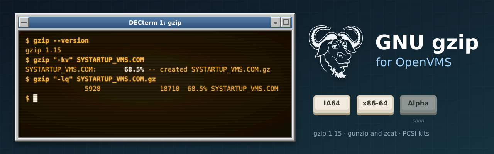

<p align="center">
  
</p>

# vms-gzip

[](https://github.com/issinoho/vms-gzip/releases/latest)
[](https://github.com/issinoho/vms-gzip/releases)

[](COPYING)

GNU gzip 1.15 for OpenVMS (IA64, x86-64 and Alpha), built natively with VSI C.

The repository stores only our changes over the signed upstream release: `patches/`
(changes to upstream files, applied in `patches/series` order) and `overlay/` (new files:
VMS build procedures, C RTL shims, PCSI kit, smoke test). `tools/prepare.sh` combines them
with the tarball into `staging/`, which is pushed to a VMS node and built there with MMS.

## Status

| Step | IA64 (V8.4-2L3) | x86-64 (E9.2-4) | Alpha (V8.4-2L2) |
|------|-----------------|-----------------|------------------|
| Build (`tools/build.sh`) | clean | clean | no errors (see below) |
| DCL smoke test, 25 checks (`tools/test.sh`) | 25/25 | 25/25 | 25/25 |
| PCSI kit `ISSINOHO <base> GZIP V1.15-0E1` (`tools/kit.sh`) | built | built | built (V1.15-0E2) |
| Install check (`tools/installcheck.sh`): install, smoke 25/25, clean removal | pass | pass | pass |

**Alpha (v1.15-vms2, a dedicated Alpha release; IA64 and x86-64 stay on vms1):** built on
OpenVMS Alpha V8.4-2L2 with VSI C V7.4-002 (about 47 `%CC-I-QUESTCOMPARE` and 2 `QUESTCOMPARE1`
informational messages; five `%CC-W-UNSUPCONVSPEC` in `gzip.c` for `%ju` and `%*jd`, which a
probe checked up to the 64-bit limits and `gzip -l` matched Linux gzip); DCL smoke test 25/25;
kit `ISSINOHO-AXPVMS-GZIP-V0115-0E2-1.PCSI`. The Alpha shares the IA64-derived `config.h`,
checked by compiling, linking and preprocessing all 308 test programs of the IA64 configure run
on the node (same verdict for every one) plus a run-time probe; see
`overlay/vms/config/vms-manual.site`. On the Alpha a 4.4 MB binary file round-trips with an
identical CHECKSUM, and a `.gz` made by Linux gzip decompresses to the same bytes (and the
other way). gzip's own test suite needs GNV, which the Alpha node does not have, so only the
smoke test and these manual checks run there. The Alpha build is the portable C code (the
assembly `match.S` is MS-DOS only).

**Requirements:** OpenVMS IA64, x86-64 or Alpha with VSI C and MMS (tested on IA64 V8.4-2L3,
x86-64 E9.2-4 and Alpha V8.4-2L2 with VSI C V7.4-002). On the host: git, bash, python3, gcc and
make, curl, gpg, groff, and ssh/sftp for the automated route. GNV for gzip's own test suite
(not available on the Alpha node).

`gzip -l` output for a VMS text file matches Linux gzip byte for byte (records become
LF-terminated lines). See `docs/TESTING.md` for what the smoke test covers.

## Workflow

```sh
cp tools/nodes.conf.example tools/nodes.conf   # then fill in the real nodes
tools/prepare.sh                               # fetch, verify, patch, configure, stage
tools/build.sh <ia64|x86|alpha> [ALL|CLEAN]    # push staging/ and build with MMS (a batch job on the Alpha)
tools/test.sh <node>                           # DCL smoke test
tools/kit.sh <node>                            # PCSI kit -> out/kits/
tools/installcheck.sh <node>                   # install kit, smoke-test it, remove (changes the system)
tools/vms_configure.sh <node>                  # once per upstream release: configure with VSI C (the Alpha reuses the IA64 answers)
```

## VMS changes

| Patch / file | Why |
|---|---|
| `0001-getprogname-vms` | gnulib `getprogname()` from the image name (`JPI$_IMAGNAME`) |
| `0002-stdlib-vms-exit-severity` + `vms/vms_exit.c` | failures have error severity under DCL; `$?` stays POSIX under GNV |
| `0003-config-h-assert-guard-vms` | VSI C `<assert.h>` include guard defeats gnulib's re-include |
| `0004-gzip-open-directory-vms` | `-r`: the C RTL cannot `open()` a directory; VMS-syntax directories (`[.dir]`) list VMS-form names |
| `0005-stdio-fwrite-records-vms` + `vms/vms_fwrite.c` | each `fwrite()` item became a record on record-oriented output |
| `0006-gzip-program-name-vms` | messages said `GZIP.EXE:`; now `gzip:` (and `gunzip`/`zcat` images work by name) |
| `NO_SIZE_CHECK` (`ccflags.txt`) | `st_size` of a record file counts record overhead, so every text file warned "file size changed while zipping" |
| `vms/vms_crtl_init.c` | DECC$ features: ODS-5 names, Unix name reporting, argument case |

Known limits (also in the kit's README.VMS): `.gz` keeps no VMS file attributes, so binary
files come back as Stream_LF and need `SET FILE/ATTRIBUTES`; `>` on the command line is not
handled by the C RTL (use `PIPE`); the `z*` shell scripts are not shipped.

## Roadmap

1. gzip's own test suite under GNV, as for grep and sed.
2. ~~A port to OpenVMS **Alpha**.~~ Done: see Status (Alpha kit, patch level 2).

## Licence

GNU gzip is free software under the GNU General Public License, version 3 or later;
see `COPYING`. Our patches and VMS files are distributed under the same terms.

## Artwork

`docs/images/banner.svg` and `docs/images/icon.svg` were made for this project in the style of
classic DECwindows and VT terminals, like those of its sibling ports. They incorporate the
[GNU head](https://www.gnu.org/graphics/heckert_gnu.html) by Aurelio A. Heckert, © 2003 Free
Software Foundation, Inc., used under the Creative Commons Attribution-ShareAlike 2.0 licence.
The two images are therefore also licensed under
[CC BY-SA 2.0](https://creativecommons.org/licenses/by-sa/2.0/).
